# 📷 atomcam_tools

> 🚀 ATOMCam/ATOMCam2/AtomSwing/WyzeCamV3の機能を拡張するツールキット

これは標準的な機能に満足できないユーザーが、各自の責任において機能を拡張するためのツール・スクリプトをまとめたものです。

## ⚠️ 免責事項・重要な注意点

- ⚠️ 利用にあたって、カメラメーカへの問い合わせなどは厳に慎んでください
- 🔧 自由に利用できますが、悪用して他人へ迷惑をかけた場合の責任は、設定を行った者が負うものです
- 🐛 質問、動作不具合、機能のリクエストは[Issues](https://github.com/mnakada/atomcam_tools/issues)を立ててください

## 📸 対応カメラとプレビュー

📱 AtomSwingの画面

<kbd>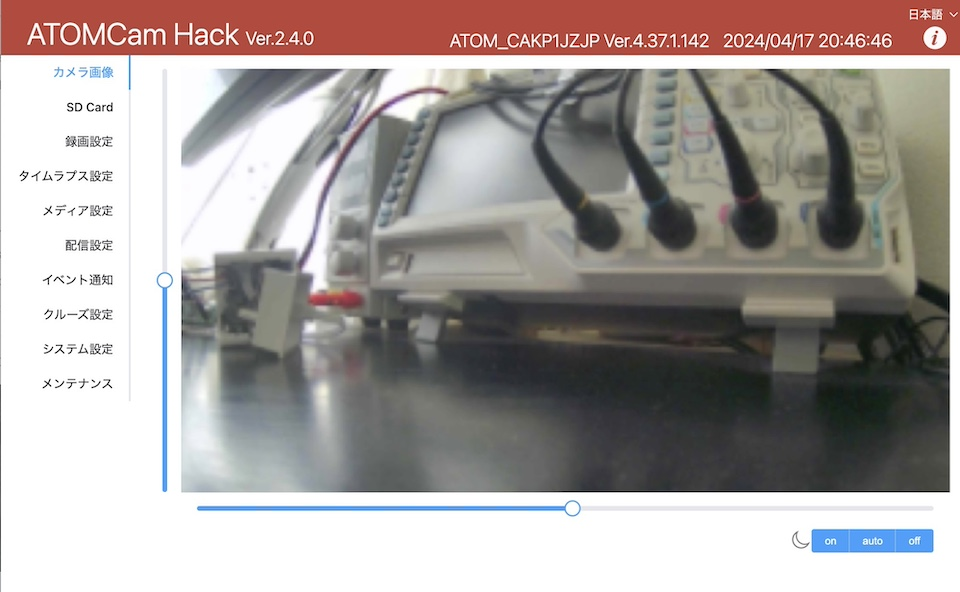</kbd>

📱 WyzeCamV3の画面

<kbd>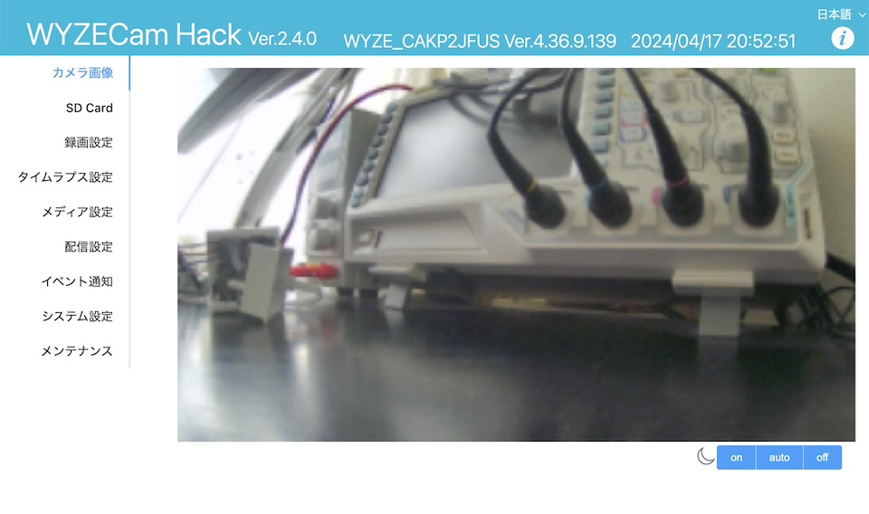</kbd>

## ✨ 実現される機能

### 🖥️ Web UI機能 (Port: 80)
- 🎛️ ATOMCamアプリから設定できない追加機能の設定
- 🔐 アカウントとパスワードによる認証機能

### 📂 ファイル共有機能
- 🌐 **CIFS(Samba4.0)サーバー** (Port: 137,138,139,445)
  - SD-Cardの映像フォルダーをLAN内でguestアカウント共有
- 🔍 **Web経由でのSD-Card記録映像閲覧**

### 💾 NAS保存機能
- 📥 CIFS(SMB)プロトコルでNASへ自動保存
- ⚠️ SMB1.0はセキュリティ的に非推奨のため非対応（SMB2.0以上対応のNASが必要）

### 🎬 録画・配信機能

#### ⏱️ Time Lapse録画
- 📅 定期的に周期と回数を指定してタイムラプス録画を実行
- 🎞️ SD-Cardの`time_lapse/`フォルダに中間ファイルを生成し、最後にMP4に変換

#### 📡 RTSPServer (Port: 8554,8080)
- 🎥 **ATOMCam**: Main(video0)に1080p AVC/HEVC、Sub(video1)に360p HEVC
- 🎥 **WyzeCamV3**: Main(video0)に1080p AVC、Sub(video1)に320p AVC

#### 🏠 HomeKit対応
- 🍎 Apple HomeKitアクセサリーとして機能
- ⚠️ 登録時に「認証されていないデバイス」と表示されますが、そのまま登録してください

#### 📺 RTMP対応（YouTube Live配信）
- 🔴 YouTube Liveへの直接配信が可能

#### 🌐 WebRTC対応 (Port: 8555)
- 📱 LAN内でのWebRTC配信に対応

### 🔧 システム機能

#### 🌍 avahi(mDNS)機能 (Port: 5353)
- 🏷️ microSDカードの`hostname`ファイル編集でデバイス名変更可能（WebUIからも変更可能）
- 📋 hostnameの命名規則：英数と`-`(hyphen)のみ（RFC952,1123準拠）、`_`(underscore)は使用不可
- 🔗 mDNS対応OS（Windows10以降/macOS/avahi入りLinux）から`[hostname].local`でアクセス可能

#### 🔑 SSH機能 (Port: 22)
- 🗝️ microSDカードのrootディレクトリに`authorized_keys`ファイルで公開鍵認証
- 🚫 rootアカウントのパスワードログイン無効
- 💻 `ssh root@[ATOMCamのIPアドレス]` または `ssh root@[hostname].local` でログイン

#### 🔔 webHook機能
- 📢 各種イベント発生時に指定URLへPOST通知

#### ⚡ 動体検知最適化
- ⏰ 動体検知アラームの不感知期間を5分から30秒に短縮
- ☁️ メーカーへの迷惑防止のため、Cloudへの通知とvideo/jpegアップロードは5分以内の再送をブロック
- 💾 SD-Card、NASには検知時の12秒間ファイルと1分間ファイルを記録
- 🔗 webHook機能でイベントごとに通知可能（Raspberry Pi + Node-REDがお手軽）

#### 🔄 アップデート機能
- 📥 GitHubのLatestイメージを自動ダウンロード・更新（約3分）
- ⚠️ AtomCamのFWアップデートはWebUIから不可（アプリから実行してください）

#### 🔄 AtomCam FWアップデート対応
- 💿 アプリからのFWアップデート時にSD-Card抜去不要
- ⚡ 商品と同じubootシーケンスでflashメモリの消去・書き込み
- ⚠️ アップデート中の電源断は絶対に避けてください

### 🎯 AtomSwing専用機能

#### 🔄 Pan/Tilt制御
- 🖱️ WebUIからのpan/tilt操作
- ⚠️ 自動追跡ON時は映像移動による物体認識の競合に注意
- 🔧 pan/tilt座標系初期化のリセット機能（メンテナンスページ）

#### 🛣️ クルーズシーケンス制御
- 📝 WebUIからのpan/tilt座標と待ち時間の登録
- 👁️ 待ち時間中の動体検知・追尾の選択可能

### 💻 カスタマイズ機能

#### 📜 起動スクリプト
- 🚀 SD-Cardに`post_icamera.sh`があると自動実行
- 🔒 RootFSがReadOnlyのため、hook pointとして提供

#### 💿 FAT32 + exFAT構成対応
- 💾 FAT32上限の2TB以上のSD-Card使用可能
- ⚠️ **重要**: 256MB以上のメディアではAtomCamのFWバグでrecordフォルダのファイルが削除される問題あり
  - 詳細: [SD-Cardのrecord以下のファイルが保存日数前に削除される #91](https://github.com/mnakada/atomcam_tools/issues/91)

**パーティション構成:**
- 1st partition: FATFS boot（16MB以上推奨）
  - `factory_t31_ZMC6tiIDQN`のみ配置
- 2nd partition: ExFAT atomtools（残りのサイズ）
  - `rootfs_hack.squashfs`, `hostname`, `authorized_keys` など

#### 🎥 ビデオ設定
- **📊 Bitrate設定**
  - Main HD: 300〜2000bps（高値は負荷増加）
  - Sub 360p/320p: 100〜500bps（高値は負荷増加）
- **🎞️ Framerate設定**
  - 1〜30fps範囲（25fps程度が妥当、それ以上は動作不安定の可能性）

#### 🏷️ Watermark置き換え
- 🖼️ 左下のwatermark（ロゴ）のカスタマイズ対応

#### 📱 モバイルアプリ設定対応
- 🎛️ 一部設定項目に対応（複雑なGUIは非対応）

## 🔒 セキュリティに関わる重要事項

⚠️ **セキュリティ警告**

上記の各ポートが利用可能となるため、以下の点にご注意ください：

- 🛡️ ネットワークセキュリティを各自十分に保つように心がけてください
- 👀 WebUI、video、jpegはLAN内から自由にアクセス可能
- 🔑 SSHは物理的にSD-Cardへアクセスして公開鍵を書く必要があります
- ⚠️ ATOMCamはSSID、パスワードを平文でカメラ内フラッシュメモリに保存しているため、盗難時のWiFiアクセスリスクがあります

## 📋 対応ファームウェア

⚠️ **ファームウェア更新時の注意**

atomcam_toolsは以下のバージョンで動作確認済みです。更新により機能が使えなくなる可能性があります：

| カメラ | 対応バージョン |
|---|---|
| 📷 ATOMCam | Ver.4.33.3.68, 4.33.3.73 |
| 📷 ATOMCam2 | Ver.4.58.0.139, 4.58.0.154, 4.58.0.160 |
| 📷 AtomSwing | Ver.4.37.1.152, 4.37.1.162, 4.37.1.166 |
| 📷 WyzeCamV3 | Ver.4.36.9.139（実験的リリース）|

⚠️ **WyzeCamV3の制限事項:**
- 4.36.10.xx以降のバージョンでは動作しません
- 未検証・未対応の機能があります
- H.265には対応していません

## 📚 関連記事

Qiitaに解説記事を公開しています：

- 📝 [ATOMCam2を少し改造して導入してみた](https://qiita.com/mnakada/items/7d0fbcb6e629e1ddbd0c)
- 📝 [AtomSwingを少し改造して遊んでみた](https://qiita.com/mnakada/items/5da19a302b0f7521f225)
- 📝 [atomcam_toolsのtimelapseの負荷低減](https://qiita.com/mnakada/items/eddbf8b6f0095e279095)
- 📝 [atomcam_toolsのHomeKit, RTMP対応](https://qiita.com/mnakada/items/00747fdf048f18a787ff)
- 📝 [ATOMSwingのtimelapseで星座追尾](https://qiita.com/mnakada/items/e2337f7b73e3a9e1539c)
- 📝 [atomcam_toolsのMobileApp代替機能の実装](https://qiita.com/mnakada/items/310954397db6f16fe0b5)

### 🤖 AI解説ページ
- 🔗 [Devinによるatomcam_tools構造解説（英語）](https://deepwiki.com/mnakada/atomcam_tools)
- 🔗 [Devinによるatomcam_tools構造解説（日本語翻訳）](https://translate.google.com/translate?sl=auto&tl=ja&u=https://deepwiki.com/mnakada/atomcam_tools)

## 🚀 インストール・使用方法

### 📥 ダウンロード

1. [GitHub Releases](https://github.com/mnakada/atomcam_tools/releases/latest)から`atomcam_tools.zip`をダウンロード
2. 適当なツールで解凍

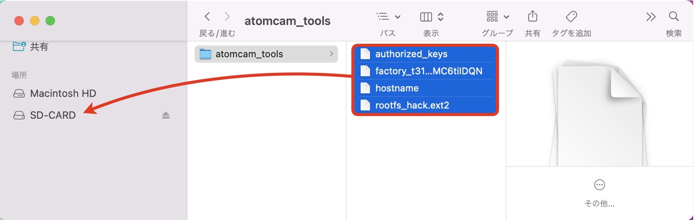

### 📁 ファイル配置

1. 解凍された**すべてのファイル**をATOMCam用microSDカードのルートフォルダに保存
2. **複数台運用の場合**: `hostname`ファイルを編集して重複を避ける
3. microSDカードをATOMCamに挿入して電源ON

### 💾 SD-Card推奨仕様

- ⚡ **できるだけ高速なClass10以上**を推奨
- 📁 **FAT-FS**でフォーマットしてください
- ❌ exFATは非対応（AtomCamのu-bootがFATFSのみ対応）
- 💭 メモリ不足をSD-Card上のswapで補うため、低速メディアは動作不安定の原因となります

## 🌐 Web設定画面の使用方法

### 🔗 アクセス方法

1. **mDNS対応環境**: `http://atomcam.local` を開く
2. **mDNS非対応環境**: ATOMCam純正アプリやIPアドレス確認ツールでIPアドレスを確認し、`http://[ATOMCamのIPアドレス]`を開く

<kbd></kbd>

### 🎛️ 画面構成

- **タイトルバー**: ツールバージョン・カメラ種類・時刻・言語設定・ヘルプリンク
- **左サイドバー**: 各設定ページのタブ切り替え

---

## 📖 詳細設定ガイド

### 📷 カメラ画像ページ

**初期表示ページ**

- 🎮 **AtomSwing**: Pan/Tiltスライダーでカメラ操作
- 📷 **AtomCam/WyzeCamV3**: スライダー非表示
- 🌙 **ナイトビジョン**: 右下ボタンでon/auto/off切り替え

### ⚙️ カメラ設定（ATOMCam/ATOMSwingのみ）

<kbd>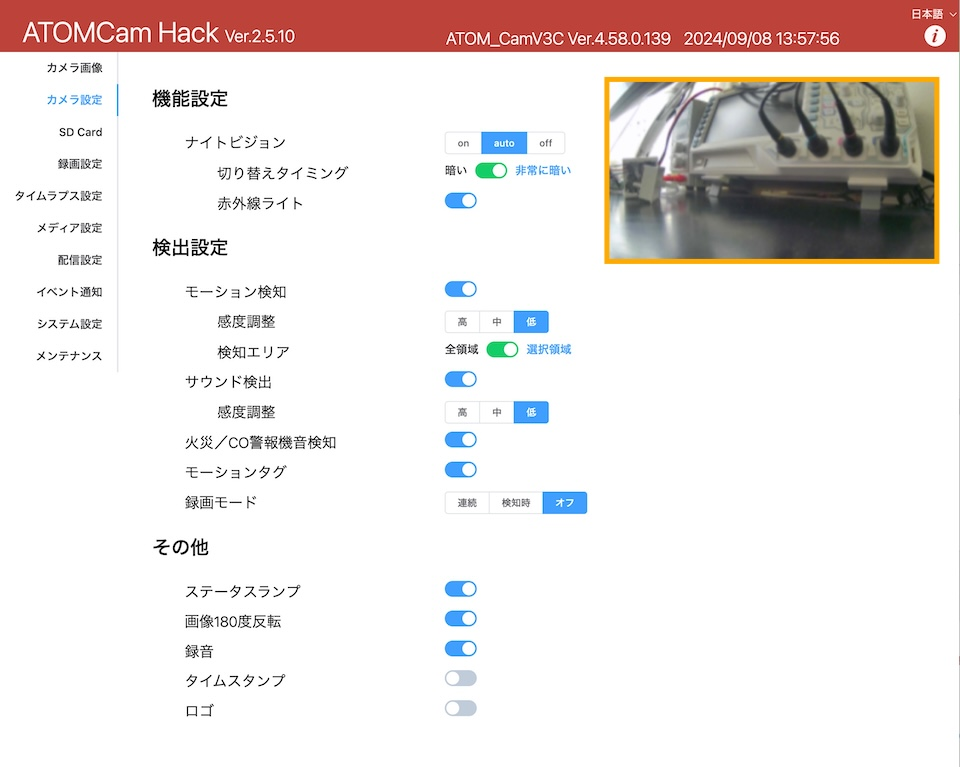</kbd>

ATOMアプリの設定項目をWebから操作可能。設定は即時反映されます。

#### 🔧 機能設定

##### 🌙 ナイトビジョン
- **ON**: 暗視白黒画像
- **OFF**: カラー画像
- **AUTO**: 環境に応じて自動切り替え

##### ⏰ 切り替えタイミング（AUTO選択時）
- **暗い** / **非常に暗い** から選択

##### 💡 赤外線ライト（ON/AUTO選択時）
ナイトビジョン時の赤外線ライト点灯設定

#### 👁️ 検出設定

##### 📹 モーション検知
- モーション検知録画の有効/無効
- ❗ ここがOFFだと録画設定のモーション検知録画が動作しません

##### 🎚️ 感度調整
**高** / **中** / **低** から選択

##### 🎯 検知エリア
- **全領域** / **選択範囲** の切り替え
- 選択範囲時はオレンジ枠で範囲設定

##### 🔊 サウンド検知
音声による検知録画の設定

##### 🚨 火災/CO警報音検知
特定警報音による検知録画

##### 🏷️ モーションタグ
検知時の緑色枠表示

##### 📼 録画モード
- **連続録画**: 常時録画
- **検知時のみ**: モーション検知時のみ
- **録画なし**

#### 🔧 その他設定

##### 💡 ステータスランプ
正面LED点灯設定

##### 🔄 画像180°反転
画像の上下反転

##### 🕐 タイムスタンプ
画面右側の時刻表示

##### 🏷️ ロゴ
- 左下watermark（ロゴ）の表示設定
- デフォルト: `atomcam_tools`文字
- 変更: システム設定から可能
- 元のATOMロゴに戻す: SD-Cardの`watermark.bgra`を削除して空ファイル作成

#### 🔬 詳細設定

<kbd>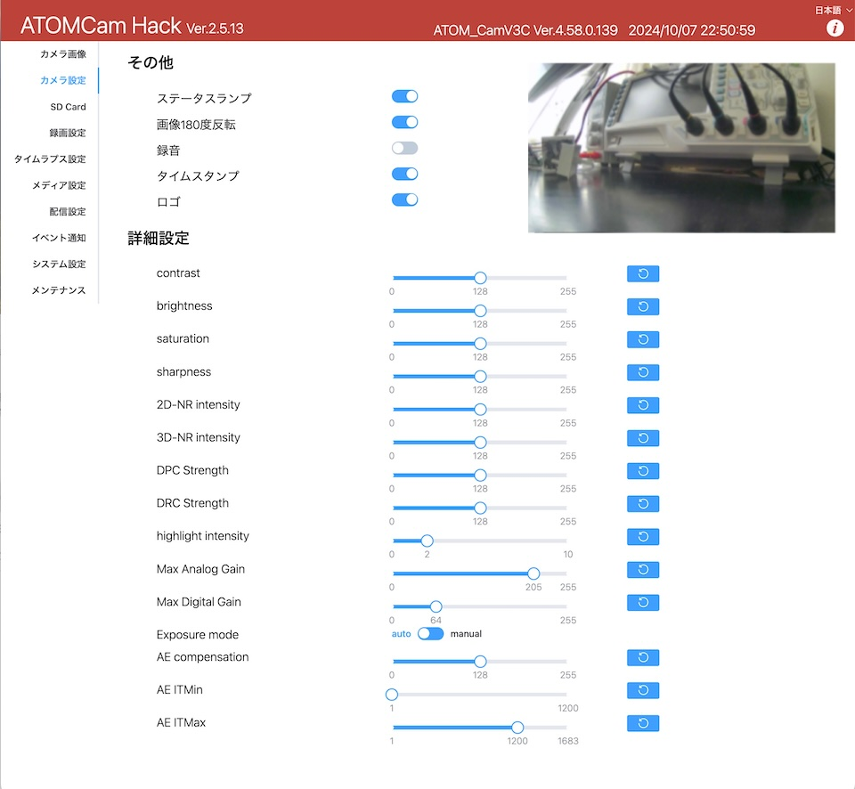</kbd>

##### 🎨 ISP設定
- カメラのISP設定値変更（即時反映・再起動後も維持）
- 🔄 デフォルト復元: Refreshボタン
- 📊 対応項目: contrast～sharpness等

### 💾 SD Cardページ

<kbd>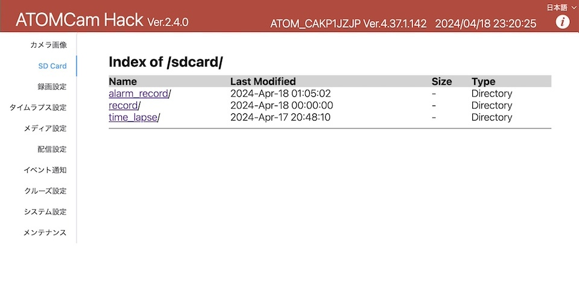</kbd>

カメラ内SD-Cardの映像記録フォルダーにアクセス：

- 📁 **alarm_record**: モーション検知録画
- 📁 **record**: 連続録画
- 📁 **time_lapse**: タイムラプス

🎬 ファイルクリックでMP4/JPEG再生。SMBアクセスより低負荷です。

### 📹 録画設定

<kbd>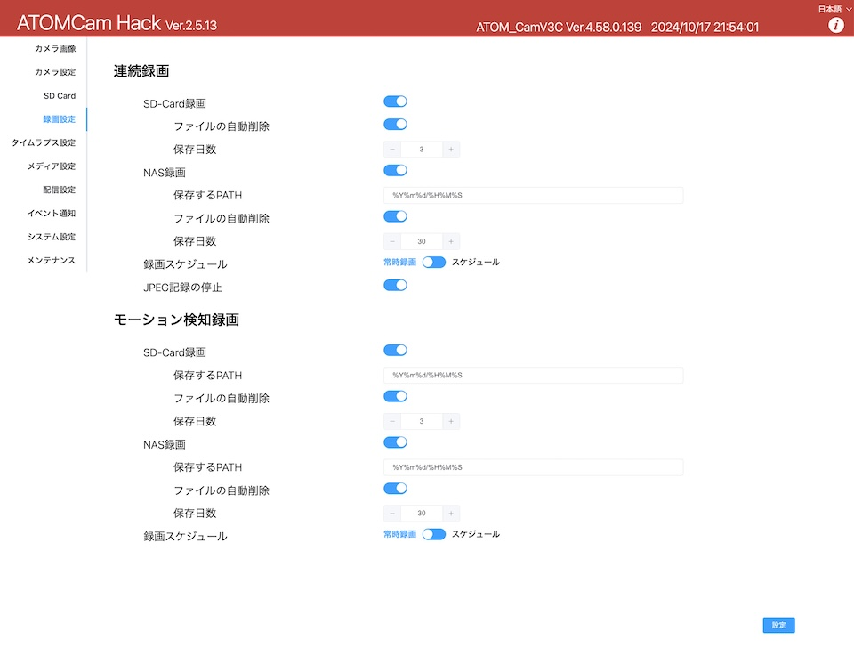</kbd>

#### 📼 連続録画
- SD-Card/NASの`record`フォルダに1分ごとのファイル記録
- ❗ モバイルアプリアクセスのため、SD-Cardファイル名は変更不可

#### 🎯 モーション検知録画
- ATOMCamアプリ設定の検出時に、クラウド保存される12秒映像をSD-Card/NASにも記録
- 📁 保存先: `alarm_record`フォルダ
- ⚠️ **重要**: 「録画ファイルの自動削除」で保存日数を指定しないと削除されません

#### ⚙️ 録画設定項目

##### 💾 SD-Card録画 / NAS録画
各メディアへの記録有効/無効

##### 📂 保存PATH
- strftime形式での指定
- 最後の`/`以降はファイル名（自動で`.mp4`付加）
- 例: `%Y%m%d/%H%M%S` → `/alarm_record/20211128/223000.mp4`
- フォルダ自動作成

##### 🗑️ ファイル自動削除
指定日数経過後の自動削除機能

##### 📅 保存日数
録画ファイル保持期間

##### ⏰ 録画スケジュール
- 曜日・時間帯指定
- 複数条件OR設定
- ➕➖ボタンで項目追加・削除

##### 📸 JPEG記録停止
`/media/mmc/record`ディレクトリへのJPEG記録停止

### ⏱️ タイムラプス設定

<kbd>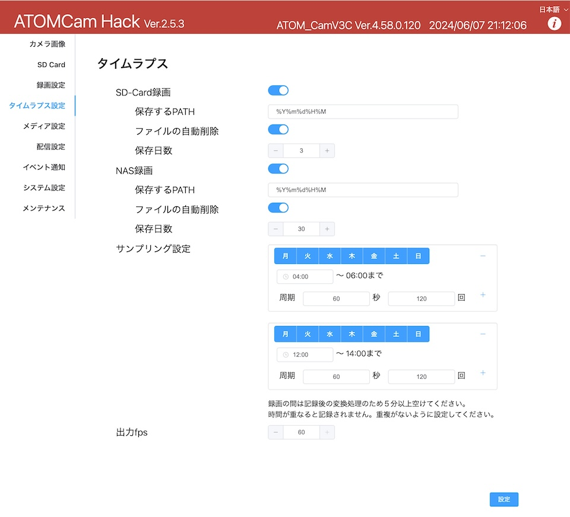</kbd>

一定時間毎の映像記録で早送り動画作成。設定項目は録画設定とほぼ同様。

#### 📅 サンプリング設定
- 開始曜日・時間指定
- 周期・回数指定で枚数決定
- 指定フレームレートで録画ファイル生成
- ⚠️ **重要**: サンプリング時間が重複しないよう設定
- 🚫 実行中の重複はスキップされます
- ⏱️ 次回録画まで5分以上間隔を推奨（MP4変換時間考慮）

#### 🎞️ 出力fps
再生フレームレート（1秒間の表示枚数）

#### 📊 動作状態
実行中の進捗表示

#### ⏹️ 中止
- Lock解除後に中止ボタン
- MP4ファイル生成して停止

### 💿 メディア設定

<kbd>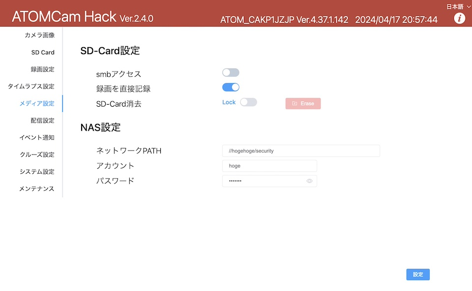</kbd>

#### 💾 SD-Card設定

##### 🌐 SMBアクセス
- Samba4.0でネットワークフォルダ公開
- 対象: `/record`, `/time_lapse`, `/alarm_record`
- ⚠️ **注意**: 負荷大のためRTSPストリーミングと同時使用非推奨
- 💡 **推奨**: Webアクセスの方が低負荷

##### 💾 録画を直接記録
- **OFF**: RAM-Disk経由でSD-Cardにコピー
- **ON**: SD-Cardに直接ファイル生成
- 🔧 SD-Cardスピードと設定に応じて最適化が必要

##### 🗑️ SD-Card消去
- `record`, `alarm_record`, `time_lapse`フォルダ消去
- 🔒 アプリからのフォーマット無効化の代替手段
- 🔓 Lock解除後にEraseボタン

#### 🌐 NAS設定

##### 📡 ネットワークPATH
`//[ホスト名]/[フォルダー名]`形式で指定

##### 👤 アカウント・パスワード
- NASアクセス用認証情報
- ⚠️ パスワードは平文でSD-Cardに保存

### 📡 配信設定

<kbd>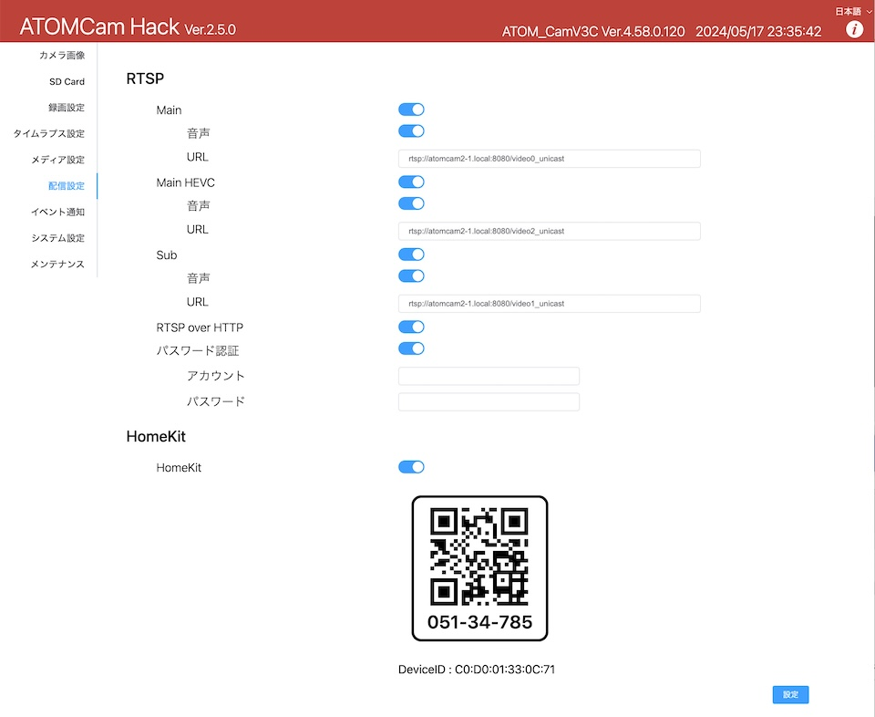</kbd>

⚠️ **パフォーマンス注意**: 配信は高負荷処理のため、使用しない機能はOFFにしてください

#### 📺 RTSP設定

##### 🎥 Main (video0)
- HD AVC出力
- VLC等での「ネットワークストリーミング」対応
- 🔊 音声: OFF/OPUS/AAC選択

##### 🎥 Main HEVC (ATOMCamのみ, video2)
- HD HEVC出力
- RTSPのみ対応

##### 📱 Sub (video1)
- 360p/320p出力
- RTSPのみ対応

#### 🌐 RTSP over HTTP
- UDP代わりにHTTP経由送出
- パケット保障あり・遅延可能性あり
- URLが変更されます

#### 🔐 パスワード認証
RTSPアクセスの認証設定

#### 🏠 HomeKit

<kbd>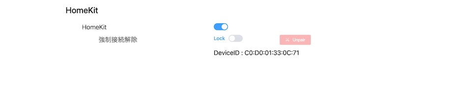</kbd>

- ON後に設定ボタンでQRコード表示
- iOSホームアプリでQRコード読み取り
- ⚠️ 同時接続は1つのiOS/HomeHUBのみ

##### 🔌 強制接続解除
iOS解除後もQRコード非表示の場合に実行

#### 📺 RTMP（YouTube Live配信）

<kbd>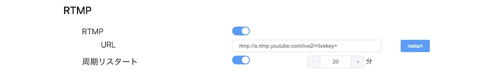</kbd>

- YouTube Live URL: `rtmp://a.rtmp.youtube.com/live2/<livekey>`
- YouTube Studioでライブ配信設定確認
- 🔄 周期リスタート機能（1日程度での停止対策）

#### 🌐 WebRTC

<kbd></kbd>

- LAN内WebRTC配信
- URLコピーまたはLinkボタンでアクセス

### 🔔 イベント通知

<kbd>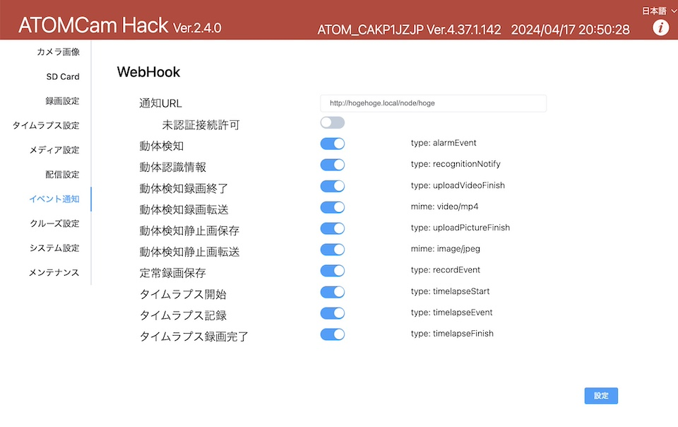</kbd>

#### 🪝 WebHook
各種イベントタイミングでURL通知

##### 📡 通知URL
- LAN内non-secure POST想定
- フォーマット: `{ type: 'event名', data: データ }`

##### 🔓 未認証接続許可
自己証明書等での接続許可

##### 📊 通知イベント一覧
- 👁️ **動体検知**: `type: alarmEvent`
- 🎯 **動体認識情報**: `type: recognitionNotify`
- 📹 **動体検知録画終了**: `type: uploadVideoFinish`
- 📤 **動体検知録画転送**: `mime: video/mp4`
- 📸 **動体検知静止画保存**: `type: uploadPictureFinish`
- 📤 **動体検知静止画転送**: `mime: image/jpeg`
- 📼 **定常録画保存**: `type: recordEvent`
- ⏱️ **タイムラプス開始**: `type: timelapseStart`
- ⏱️ **タイムラプス記録**: `type: timelapseEvent`
- ⏱️ **タイムラプス終了**: `type: timelapseFinish`

### 🛣️ クルーズ設定（AtomSwingのみ）

<kbd>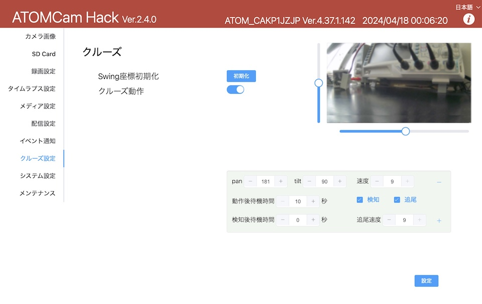</kbd>

#### 🔄 Swing座標初期化
pan/tilt座標系の初期化（モーター動作範囲リセット）

#### 🎯 クルーズ動作
- シーケンス登録順に動作・ループ
- 選択項目は薄緑色表示
- ➕➖で項目追加・削除
- ⚠️ 編集時はクルーズOFF推奨

##### 🎮 pan/tilt/速度
- 数値入力またはスライダー操作
- 速度: 1（低速）〜9（高速）

##### ⏰ 動作後待機時間
移動完了から次移動までの秒数

##### 👁️ 検知・追尾
- **検知**: 待機中の動体検知で待機延長
- **追尾**: 検知後の動体追尾機能
- 🕐 検知後待機時間設定

##### ⚡ 追尾速度
追尾時の移動速度（1〜9）

### ⚙️ システム設定

<kbd>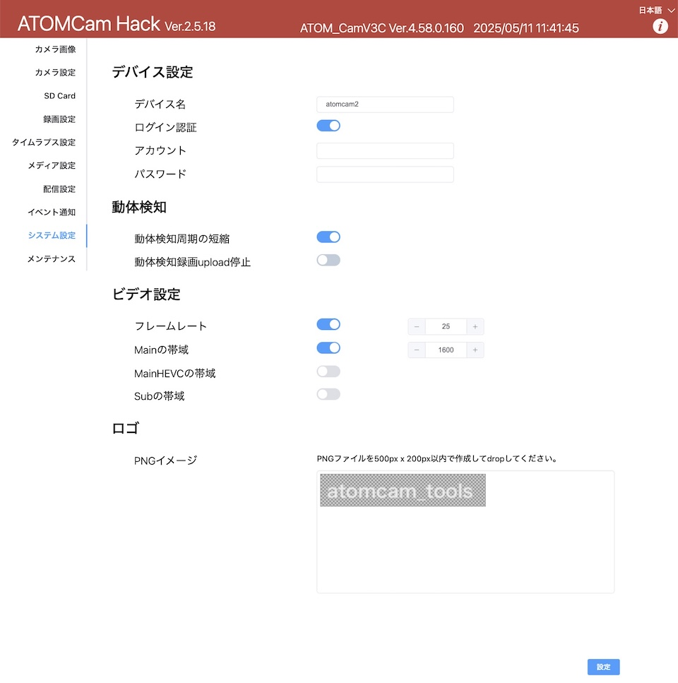</kbd>

#### 🏷️ デバイス設定

##### 📛 デバイス名
CIFS(Samba) / mDNS(avahi) / NASフォルダー名に使用

##### 🔐 ログイン認証
- WebUI簡易認証（MD5 digest認証）
- ⚠️ 安全ではないため、LAN内簡易認証用途限定
- 制限文字: `:`と`\\`は使用不可

#### 👁️ 動体検知

##### ⏰ 動体検知周期短縮
不感知期間を5分→30秒に短縮（設定変更時再起動）

##### 📤 動体検知録画アップロード停止
- AtomTech AWSサーバーへの12秒録画アップロード停止
- ⚠️ 停止するとATOMCamアプリから録画データ閲覧不可
- 設定変更時再起動

#### 🎥 ビデオ設定

##### 🎞️ フレームレート
1〜28fps設定

##### 📊 ビットレート設定
- **Main HD**: 300〜2000bps
- **Main HEVC HD**（ATOMCamのみ): 300〜2000bps  
- **Sub 360p/320p**: 100〜500bps

#### 🖼️ ロゴ設定

##### 📁 PNGイメージ
- ドラッグ&ドロップでロゴ変更
- 仕様: RGBA 8bit、500px × 200px以内
- 設定ボタンで反映

### 🔧 メンテナンス

<kbd>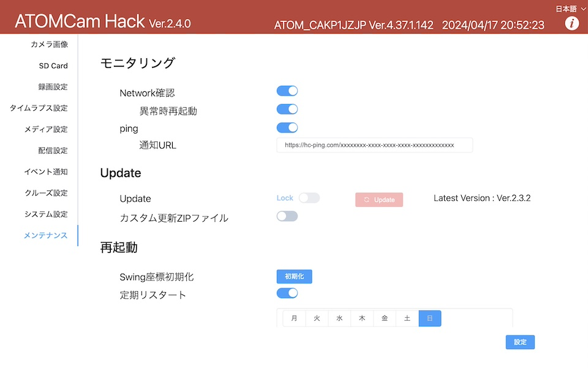</kbd>

#### 📊 モニタリング

##### 🌐 Network確認
LAN接続確認・再接続試行

##### 🔄 異常時再起動
LAN接続不可継続時のシステム再起動

##### 📡 ping疎通確認
- 定期的疎通確認
- 指定URLに1分毎HTTP GET

#### 🆙 アップデート

##### 📥 Update
- GitHub Latest Versionに自動更新（約180秒）
- 現在バージョンがLatest未満の場合のみ実行可能
- 🔄 **手動更新**: PC経由でatomcam_tools.zipをSD-Card/updateフォルダに配置後リブート

##### 📦 カスタム更新ZIPファイル
独自パッケージビルド用の指定URL更新

#### 🔄 再起動

##### ⏰ 定期リスタート
指定スケジュールでシステム再起動

##### 🔄 リブート
- 🔓 Lock解除後にRebootボタン
- 再起動時間: 60〜80秒

## 📄 著作権・ライセンス

📋 詳細はLICENSEファイルを参照してください

---

## 📞 サポート・コミュニティ

- 🐛 **バグ報告・機能要望**: [GitHub Issues](https://github.com/mnakada/atomcam_tools/issues)
- 📚 **技術解説**: [Qiita記事一覧](#-関連記事)
- 🤖 **AI解説**: [Devin構造解説](#-ai解説ページ)

---
